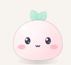
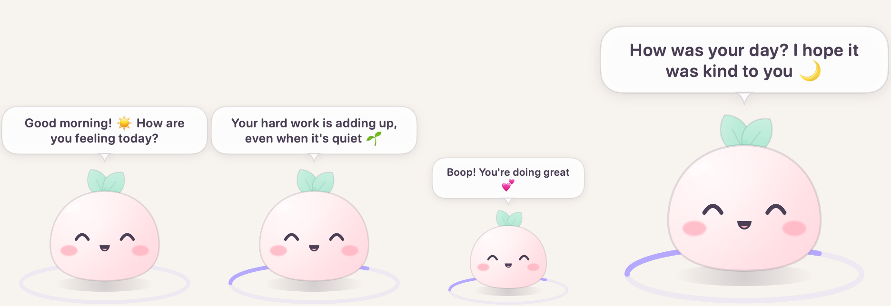
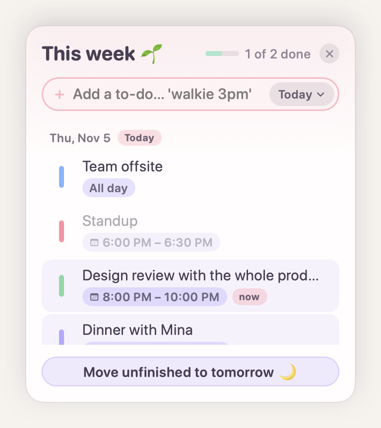
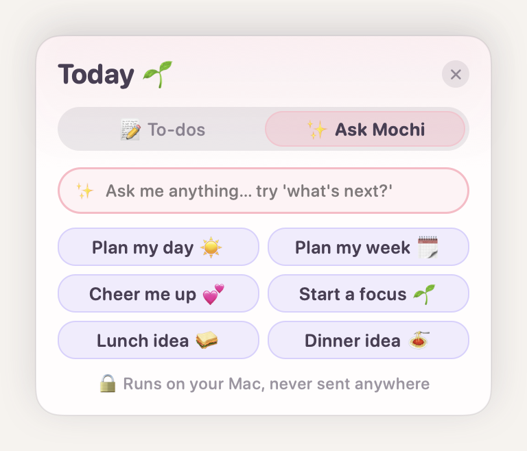
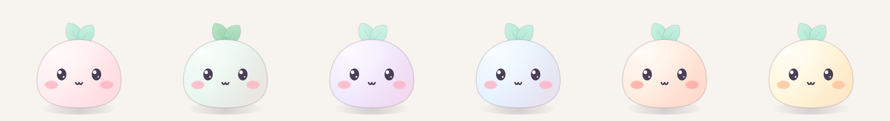
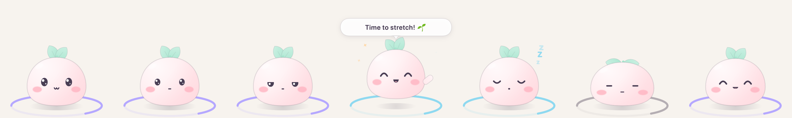

  

<h1 align="center">Mochi 🍡🌱</h1>

  A tiny friend that floats on your Mac, says sweet things, and reminds you to rest your eyes and stretch.

  <a href="https://github.com/Anhlam09/mochi-app/releases/latest"><b>⬇️ Download Mochi</b></a>
  &nbsp;·&nbsp;
  <a href="https://anhlam09.github.io/mochi-site/">Website</a>

  <picture>
    <source srcset="images/talking_dark.png" media="(prefers-color-scheme: dark)">
    
  </picture>

## What Mochi does

- ⏰ **Break reminders:** gentle 20-20-20 eye breaks, Pomodoro, or your own timer.
- 💬 **Talks to you:** good-morning hellos, check-ins, kind words and cute fun facts.
- 📝 **To-dos:** plan your week, with dates and a day picker.
- ✨ **Smart Mochi:** plans your day, cheers you up and suggests meals, using Apple's on-device AI.
- 🎧 **Talk to Mochi:** hold Option + M, talk, let go.
- 🎨 **Six flavors:** strawberry, matcha, taro, ramune, peach and banana.
- 🔒 **Private:** no accounts, no tracking. Everything runs on your Mac.

  <picture>
    <source srcset="images/todos_dark.png" media="(prefers-color-scheme: dark)">
    
  </picture>
  <picture>
    <source srcset="images/ask_dark.png" media="(prefers-color-scheme: dark)">
    
  </picture>

<picture>
  <source srcset="images/flavors_dark.png" media="(prefers-color-scheme: dark)">
  
</picture>

<picture>
  <source srcset="images/scenes_dark.png" media="(prefers-color-scheme: dark)">
  
</picture>

## Install

Requires macOS 14 Sonoma or newer (Apple Silicon or Intel).

1. Download `Mochi-0.2.0.zip` from [Releases](https://github.com/Anhlam09/mochi-app/releases/latest) and double-click it to unzip.
2. Drag **Mochi** into your **Applications** folder.
3. Open Mochi. If your Mac shows a warning, click **Done**.
4. Open **System Settings → Privacy & Security**, scroll down, and click **Open Anyway** next to Mochi.
5. Look for 🌱 in your menu bar.

## About this repository

Mochi is built with Swift and SwiftUI. Its source code is private: this repository has only screenshots and the finished app downloads.

© 2026 Anh Lam. All rights reserved. See [LICENSE](LICENSE).
